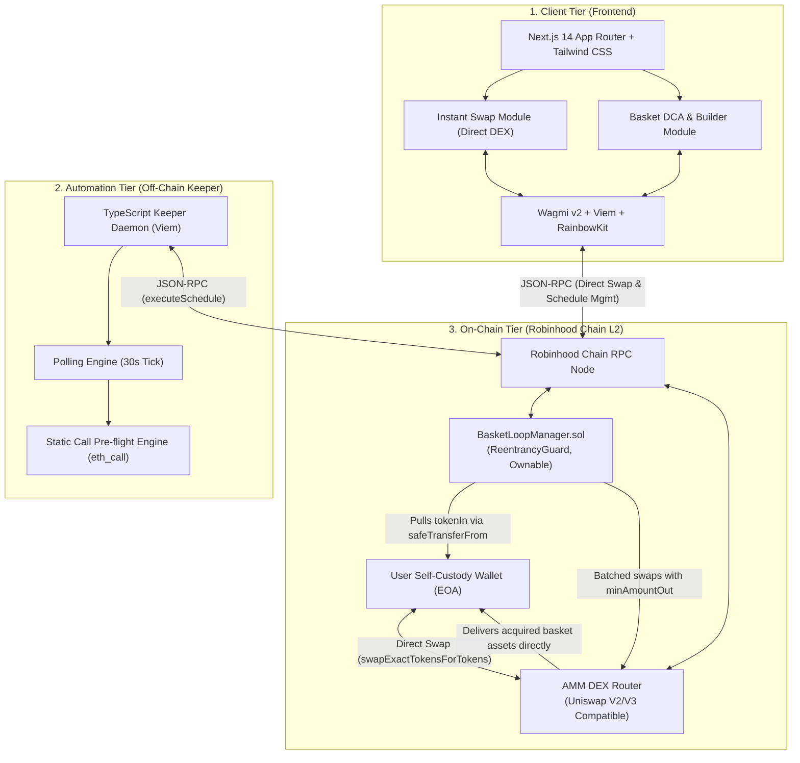
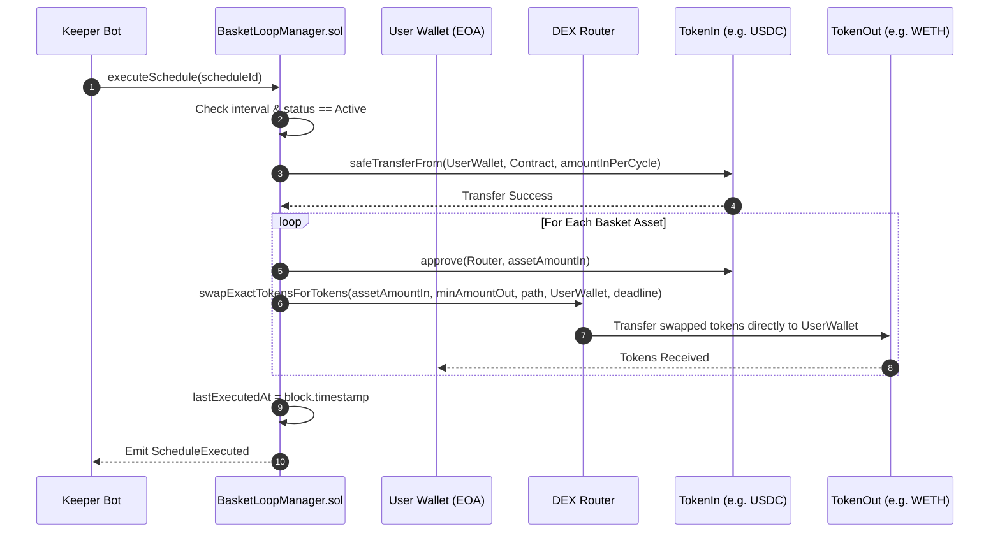
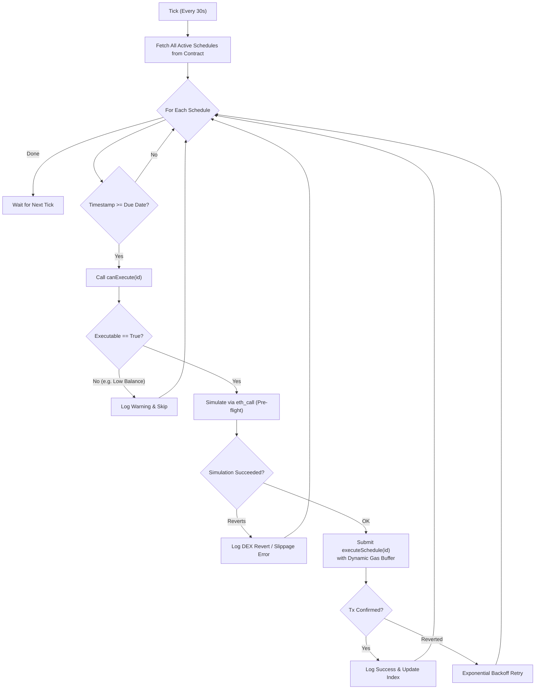
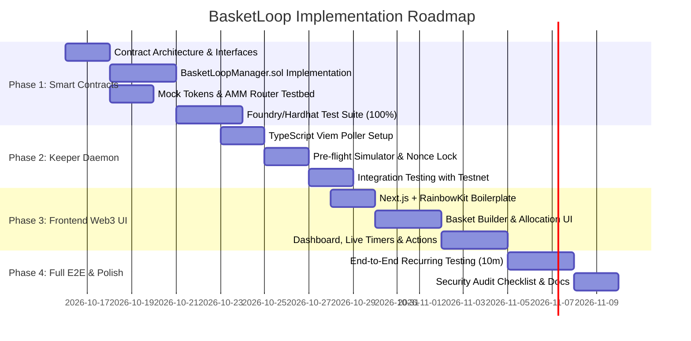

# Technical Architecture & Smart Contract Design — BasketLoop

**Document Version:** 1.0.0
**Status:** Approved for Implementation
**Date:** October 16, 2026
**Target Environment:** Robinhood Chain (Arbitrum Orbit L2) / Arbitrum Sepolia Testnet
**Compatible Solidity Version:** `^0.8.20`

---

## 1. System Architecture Overview

BasketLoop provides a dual-engine architecture:
1. **Instant 1:1 Swap Engine:** Standard direct DEX swaps for immediate token trades, routed directly between the user's wallet and the AMM router.
2. **Basket Investment Engine:** Automated multi-asset recurring portfolio accumulation (and instant multi-token basket purchases) managed by `BasketLoopManager.sol` and the background keeper daemon.



### 1.1 Non-Custodial Core Invariants
1. **Zero Idle Balances:** The protocol never holds user funds between scheduled executions. At the conclusion of any transaction, the smart contract's balance of all ERC-20 tokens is strictly zero.
2. **Deterministic Periodic Pulls:** Tokens can only be transferred from a user's wallet if:
   * Current timestamp $\ge \text{lastExecutedAt} + \text{intervalSeconds}$.
   * The schedule status is strictly `Active`.
   * The pulled amount equals exactly `amountInPerCycle` (never exceeding the authorized periodic budget).
3. **Atomic Multi-Asset Execution:** All asset swaps for a basket cycle execute within a single transaction. If any single swap fails or breaches slippage limits, the transaction reverts completely, leaving user wallet balances 100% untouched.

---

## 2. Smart Contract Architecture (`contracts/`)

The contract layer is intentionally monolithic for the MVP to minimize cross-contract call gas overhead and deployment complexity on Arbitrum Orbit.

### 2.1 Contract Hierarchy & Dependencies
```text
OpenZeppelin Ownable (^0.8.20)
       │
OpenZeppelin ReentrancyGuard (^0.8.20)
       │
OpenZeppelin Pausable (^0.8.20)
       │
┌──────┴─────────────────────────────────┐
│        BasketLoopManager.sol           │
└────────────────────────────────────────┘
       ▲                     ▲
       │                     │
IERC20 / SafeERC20     ISwapRouter / IUniswapV2Router02
```

### 2.2 Data Structures & Storage Layout

```solidity
// SPDX-License-Identifier: MIT
pragma solidity ^0.8.20;

enum ScheduleStatus {
    Active,     // 0: Due for execution when interval elapses
    Paused,     // 1: Temporarily suspended by user
    Cancelled   // 2: Permanently terminated by user
}

struct BasketAsset {
    address token;          // ERC-20 target token contract address
    uint16 allocationBps;   // Allocation in basis points (100 bps = 1.00%, sum must = 10000)
}

struct Schedule {
    uint256 id;                 // Unique auto-incrementing schedule identifier
    address owner;              // EOA wallet address that created and owns the schedule
    address tokenIn;            // Funding currency (e.g., USDC, USDT, WETH)
    uint256 amountInPerCycle;   // Exact amount of tokenIn pulled per recurring cycle
    uint32 intervalSeconds;     // Cycle duration in seconds (e.g., 600, 3600, 604800)
    uint64 lastExecutedAt;      // Unix timestamp of the most recent successful execution
    uint16 slippageBps;         // Maximum allowed slippage tolerance in basis points (e.g., 100 = 1%)
    ScheduleStatus status;      // Active, Paused, or Cancelled
    string name;                // Human-readable basket label (max 32 chars)
}
```

#### State Storage Variables
```solidity
// Contract state
uint256 public nextScheduleId = 1;
address public dexRouter;
address public keeperAddress; // Authorized keeper bot address

// Core mappings
mapping(uint256 => Schedule) public schedules;
mapping(uint256 => BasketAsset[]) internal scheduleAssets;
mapping(address => uint256[]) public userSchedules;

// Constants & Bounds
uint16 public constant TOTAL_BPS = 10000;      // 100.00%
uint16 public constant MIN_ALLOCATION_BPS = 100; // 1.00%
uint8 public constant MIN_ASSETS = 2;
uint8 public constant MAX_ASSETS = 5;
uint16 public constant MAX_SLIPPAGE_BPS = 500; // 5.00% max slippage
```

---

### 2.3 Custom Error Definitions (Gas-Optimized)

To save deployment bytecode and gas fees compared to legacy revert strings, all validations use custom errors:

```solidity
error InvalidAddress();
error InvalidAssetCount(uint256 count);
error InvalidAllocationSum(uint256 totalBps);
error AllocationTooSmall(uint256 bps);
error DuplicateAsset(address token);
error AssetCannotBeFundingToken();
error InvalidAmount();
error InvalidInterval(uint32 interval);
error InvalidSlippage(uint16 slippageBps);
error ScheduleNotFound(uint256 id);
error NotScheduleOwner(uint256 id, address caller);
error ScheduleNotActive(uint256 id);
error ScheduleNotDue(uint256 id, uint256 nextDueTimestamp);
error InsufficientAllowance(address token, uint256 required, uint256 actual);
error InsufficientBalance(address token, uint256 required, uint256 actual);
error SwapExecutionFailed(address tokenOut, string reason);
error ZeroOutputReceived(address tokenOut);
error UnauthorizedKeeper(address caller);
```

---

### 2.4 Event Definitions

```solidity
event ScheduleCreated(
    uint256 indexed scheduleId,
    address indexed owner,
    address indexed tokenIn,
    uint256 amountInPerCycle,
    uint32 intervalSeconds,
    string name
);

event ScheduleExecuted(
    uint256 indexed scheduleId,
    address indexed owner,
    uint256 amountInProcessed,
    uint256 timestamp
);

event SchedulePaused(uint256 indexed scheduleId, address indexed owner);
event ScheduleResumed(uint256 indexed scheduleId, address indexed owner);
event ScheduleCancelled(uint256 indexed scheduleId, address indexed owner);
event KeeperUpdated(address indexed oldKeeper, address indexed newKeeper);
event DexRouterUpdated(address indexed oldRouter, address indexed newRouter);
```

---

### 2.5 Core Function Specifications

#### 1. `createSchedule`
```solidity
function createSchedule(
    string calldata name,
    address tokenIn,
    uint256 amountInPerCycle,
    uint32 intervalSeconds,
    uint16 slippageBps,
    BasketAsset[] calldata assets
) external whenNotPaused returns (uint256 scheduleId);
```
* **Validations:**
  * `tokenIn != address(0)`.
  * `amountInPerCycle > 0`.
  * `slippageBps >= 10 && slippageBps <= MAX_SLIPPAGE_BPS`.
  * `assets.length >= 2 && assets.length <= 5`.
  * $\sum \text{assets}[i].\text{allocationBps} == 10000$.
  * Each $\text{allocationBps} \ge 100$.
  * No duplicate token addresses; no token equal to `tokenIn`.
* **State Updates:**
  * Increment `nextScheduleId`.
  * Populate `schedules[id]` with `lastExecutedAt = block.timestamp` (or 0 for immediate first run).
  * Copy `assets` array into `scheduleAssets[id]`.
  * Append `id` to `userSchedules[msg.sender]`.
* **Emits:** `ScheduleCreated`.

#### 2. `executeSchedule`
```solidity
function executeSchedule(uint256 scheduleId) external nonReentrant whenNotPaused;
```
* **Access Control:** Caller must be `keeperAddress` or contract `owner()` (allows manual developer fallback).
* **Pre-conditions:**
  * `schedule.status == ScheduleStatus.Active`.
  * `block.timestamp >= schedule.lastExecutedAt + schedule.intervalSeconds`.
* **Execution Sequence:**
  1. Transfer `schedule.amountInPerCycle` of `tokenIn` from `schedule.owner` to `address(this)` using `SafeERC20.safeTransferFrom`.
  2. For each asset $i \in [0, N-1]$:
     * Compute asset budget:
       $$\text{assetAmountIn} = \frac{\text{amountInPerCycle} \times \text{assets}[i].\text{allocationBps}}{10000}$$
     * Approve `dexRouter` to spend `assetAmountIn`.
     * Query minimum expected output via DEX Quoter/Router, factoring in `schedule.slippageBps`:
       $$\text{amountOutMin} = \text{expectedOut} \times \left(1 - \frac{\text{slippageBps}}{10000}\right)$$
     * Call DEX swap with recipient set directly to `schedule.owner`.
     * Assert output received $> 0$.
  3. Update `schedule.lastExecutedAt = uint64(block.timestamp)`.
  4. Emit `ScheduleExecuted`.



#### 3. `executeInstantBasket` (One-Click Immediate Basket Purchase)
```solidity
function executeInstantBasket(
    address tokenIn,
    uint256 amountIn,
    uint16 slippageBps,
    BasketAsset[] calldata assets
) external nonReentrant whenNotPaused;
```
* **Purpose:** Allows a user to buy an entire multi-asset basket on demand in 1 single transaction without creating a recurring schedule.
* **Execution:**
  1. Validates allocation sum == 10000 bps and 2 to 5 assets.
  2. Pulls `amountIn` of `tokenIn` from `msg.sender` via `safeTransferFrom`.
  3. Batches swaps for each asset via the DEX router, sending acquired assets directly to `msg.sender`.
  4. Returns any residual dust to `msg.sender`.

#### 4. `canExecute` (View Helper for Keepers & UI)
```solidity
function canExecute(uint256 scheduleId) external view returns (bool executable, string memory reason);
```
* Returns `(true, "")` if:
  * Schedule exists and `status == Active`.
  * `block.timestamp >= lastExecutedAt + intervalSeconds`.
  * `IERC20(tokenIn).balanceOf(owner) >= amountInPerCycle`.
  * `IERC20(tokenIn).allowance(owner, address(this)) >= amountInPerCycle`.
* Otherwise returns `(false, reason)`.

#### 4. Schedule Lifecycle Functions
```solidity
function pauseSchedule(uint256 scheduleId) external;
function resumeSchedule(uint256 scheduleId) external;
function cancelSchedule(uint256 scheduleId) external;
```
* **Guard:** Must satisfy `msg.sender == schedules[scheduleId].owner`.
* **State Updates:** Modifies `schedules[scheduleId].status` accordingly.
* **Emits:** `SchedulePaused`, `ScheduleResumed`, or `ScheduleCancelled`.

---

### 2.6 Dedicated Limit Order Contract (`LimitOrderManager.sol`)

To maintain clean separation of concerns and preserve existing deployed DCA schedules on `BasketLoopManager.sol`, Limit Orders are managed by a dedicated non-custodial contract:

```solidity
enum OrderStatus {
    Open,       // 0: Order active and waiting for execution condition
    Filled,     // 1: Successfully executed via DEX router
    Cancelled,  // 2: Cancelled by maker and 100% refunded
    Expired     // 3: Past expiry deadline and refunded
}

struct Order {
    uint256 id;
    address maker;
    address tokenIn;        // address(0) for native ETH
    address tokenOut;       // address(0) for native ETH
    uint256 amountIn;       // Escrowed input tokens
    uint256 minAmountOut;   // Target execution output
    uint256 createdAt;
    uint256 expiry;         // Unix timestamp (0 = never)
    OrderStatus status;
}
```

#### Core Invariants & Security Guarantees:
1. **Single-Pair Escrow Invariant:** Unlike multi-asset DCA schedules where funds stay in the user's wallet until cycle execution, Limit Orders escrow $100\%$ of `amountIn` upon `createOrder` to prevent double-spending.
2. **Direct Delivery:** When `executeOrder(orderId)` is called by anyone or a keeper bot, output tokens from the DEX router are transferred **directly** to `order.maker`. Zero output tokens pass through keeper custody.
3. **Execution Condition Verification:** Execution verifies on-chain that `dexRouter.getAmountsOut` yields $\ge \text{minAmountOut}$. If market rates are unfavorable, execution reverts with `PriceConditionNotMet()`.
4. **100% Maker Refund:** The maker can call `cancelOrder(orderId)` at any time while the order is `Open`, returning $100\%$ of escrowed tokens to the maker wallet. Expired orders can be refunded by anyone via `cancelExpiredOrder(orderId)`.


---

## 3. Off-Chain Keeper Automation Architecture (`keeper/`)

The Keeper Bot daemon ensures reliable, automated recurring execution without requiring user presence.

### 3.1 Daemon Architecture
```text
keeper/
├── src/
│   ├── index.ts             # Main entry point and lifecycle manager
│   ├── config.ts            # Chain RPC, contract addresses, private key
│   ├── monitor.ts           # Interval poller (every 30 seconds)
│   ├── simulator.ts         # Pre-flight eth_call simulator
│   ├── executor.ts          # Transaction builder, gas estimator & dispatcher
│   └── logger.ts            # Structured JSON logger with Pino
├── .env.example
├── package.json
└── tsconfig.json
```

### 3.2 Polling & Simulation Algorithm


### 3.3 Nonce & Gas Management
* **Gas Strategy:** EIP-1559 transaction submission on Robinhood Chain / Arbitrum Orbit.
* **Base Fee Multiplier:** $1.15 \times \text{estimatedBaseFee}$ to guard against sudden block spikes.
* **Max Priority Fee:** Configured via environment variable (`DEFAULT_PRIORITY_FEE_GWEI=0.1`).
* **Sequential Nonce Locking:** An in-memory mutex ensures the keeper does not submit concurrent transactions with duplicate nonces.

---

## 4. Frontend Application Architecture (`frontend/`)

### 4.1 Component Tree & Page Routing
```text
frontend/
├── app/
│   ├── layout.tsx           # Providers (WagmiProvider, QueryClientProvider, RainbowKit)
│   ├── page.tsx             # Hero Landing + Active Schedules Dashboard
│   ├── create/
│   │   └── page.tsx         # 2-Step Basket Creation Wizard
│   └── globals.css          # Tailwind CSS styles
├── components/
│   ├── Navbar.tsx           # Wallet connect pill, network badge
│   ├── BasketCard.tsx       # Schedule status card with live countdown
│   ├── AllocationSlider.tsx # Drag-and-drop / numeric percentage allocator
│   ├── CustomTokenModal.tsx # ERC-20 contract inspector modal
│   ├── TxHistoryTable.tsx   # Past executions table with explorer links
│   └── BalanceWarning.tsx   # Amber alert banner for low funding balance
├── hooks/
│   ├── useBasketContract.ts # Reads/writes to BasketLoopManager
│   ├── useTokenInspector.ts # Fetches symbol, decimals, name for custom ERC-20
│   └── useScheduleTimers.ts # Countdown calculation hook
└── lib/
    ├── contracts.ts         # Contract ABI & deployed address config
    └── chains.ts            # Robinhood Chain & Arbitrum Sepolia chain definitions
```

### 4.2 State Management & On-Chain Reads
* **Wagmi v2 + Viem:** Used for contract reads via `useReadContracts` (batch multicall).
* **TanStack Query (React Query):** Caches token metadata and schedules, refetching every 15 seconds.
* **Event Watchers:** Subscribes to `ScheduleExecuted` and `ScheduleCreated` events using Viem's `watchContractEvent` to update dashboard cards immediately when an automated run finishes.

---

## 5. Mathematical Models & Decimal Normalization

### 5.1 Token Allocation Math
Solidity does not support floating point arithmetic. All percentages are computed using **Basis Points (BPS)**, where $100\% = 10,000 \text{ bps}$.

For a recurring budget $A_{\text{total}}$ of `tokenIn` and an asset allocation $BPS_i$:
$$\text{amountIn}_i = \frac{A_{\text{total}} \times BPS_i}{10000}$$

#### Decimal Handling Example:
* Funding Token: `USDC` (6 decimals). Total budget = 100 USDC ($100 \times 10^6 = 100,000,000$ base units).
* Asset A allocation: 50% ($5000 \text{ bps}$).
  $$\text{amountIn}_A = \frac{100,000,000 \times 5000}{10000} = 50,000,000 \text{ units } (50.0 \text{ USDC})$$
* Asset B allocation: 30% ($3000 \text{ bps}$) $= 30,000,000 \text{ units } (30.0 \text{ USDC})$.
* Asset C allocation: 20% ($2000 \text{ bps}$) $= 20,000,000 \text{ units } (20.0 \text{ USDC})$.
* Sum check: $50M + 30M + 20M = 100M \text{ units } (100\%)$. Exact match, zero rounding dust.

### 5.2 Slippage & Minimum Output Formula
For each swap, the minimum required output amount is enforced on-chain:
$$\text{amountOutMin}_i = \text{expectedOut}_i \times \frac{10000 - \text{slippageBps}}{10000}$$
* If `slippageBps` = 100 (1.00%) and expected output is $1.000000 \text{ WETH}$, minimum received is:
  $$\text{amountOutMin} = 10^{18} \times \frac{9900}{10000} = 0.99 \times 10^{18} \text{ WETH}$$

---

## 6. Security Threat Modeling & Mitigations

| Threat Vector | Attack Mechanism | Protocol Mitigation |
| :--- | :--- | :--- |
| **Sandwich / MEV Attacks** | Bot detects keeper's swap transaction in public mempool and manipulates AMM pool price. | 1. Strictly enforce user-configured `amountOutMin`.<br/>2. Set transaction deadline to `block.timestamp + 300` seconds.<br/>3. On Arbitrum Orbit L2, transaction sequencing is First-Come-First-Served (FCFS) with no public L1-style mempool front-running. |
| **Reentrancy on Swap** | Malicious ERC-20 token with fallback hook calls `executeSchedule` recursively. | All state changes occur before token transfers (Checks-Effects-Interactions); `nonReentrant` modifier from OpenZeppelin applied. |
| **Excessive Token Pull** | Attacker calls `executeSchedule` multiple times in a row to drain user allowance. | `block.timestamp >= lastExecutedAt + intervalSeconds` strictly enforces the waiting period between cycles. |
| **Unauthorized Schedule Modification** | Malicious user attempts to pause or cancel another user's recurring schedule. | `require(msg.sender == schedule.owner, NotScheduleOwner())` check on all mutation methods. |
| **Fee-on-Transfer Tokens** | A token burns a 2% tax on each transfer, causing DEX swap math to fail. | Contract verifies input balance deltas before and after transfer, or rejects fee-on-transfer tokens during creation validation. |

---

## 7. Network Configuration & Deployment Manifest

### 7.1 Chain Parameters
* **Primary Target:** Robinhood Chain Testnet
  * Network Name: `Robinhood Chain Testnet`
  * Architecture: `Arbitrum Orbit L2 Rollup`
  * Settlement Layer: `Ethereum`
  * Native Gas Token: `ETH`
  * EVM Compatibility: `London / Shanghai (Solidity ^0.8.20)`
* **Fallback Target:** Arbitrum Sepolia Testnet
  * Chain ID: `421614`
  * RPC URL: `https://sepolia-rollup.arbitrum.io/rpc`
  * Explorer: `https://sepolia.arbiscan.io`

### 7.2 Deployed Contract Manifest (Template)
```json
{
  "network": "Robinhood Chain Testnet",
  "chainId": 0,
  "contracts": {
    "BasketLoopManager": "0x0000000000000000000000000000000000000000",
    "MockUSDC": "0x0000000000000000000000000000000000000000",
    "MockWETH": "0x0000000000000000000000000000000000000000",
    "MockDEXRouter": "0x0000000000000000000000000000000000000000"
  },
  "keeperWallet": "0x0000000000000000000000000000000000000000"
}
```

---

## 8. Development & Implementation Roadmap



---

## 9. Future Architectural Considerations (Deferred to Mainnet)

### 9.1 Points & Rewards System (Explicitly Out of Testnet Scope)
* **Current Testnet State:** The current testnet architecture has **zero dependencies** on a points or rewards system. No points smart contracts, reward mappings, points APIs, database tables, or event listeners are present.
* **Mainnet Architectural Principles (Deferred):**
  1. *Zero Smart Contract State Bloat:* Future points tracking will be evaluated primarily via off-chain event indexing to prevent adding costly storage writes (`SSTORE`) to swap execution paths.
  2. *Strict Invariant Preservation:* Any future reward layer must remain purely additive and strictly decouple from core non-custodial invariants (funds must never be locked or redirected).
  3. *Tamper Resistance:* Points eligibility will require verified transaction hashes emitted by the core protocol, with strict token whitelisting to eliminate artificial volume inflation.
