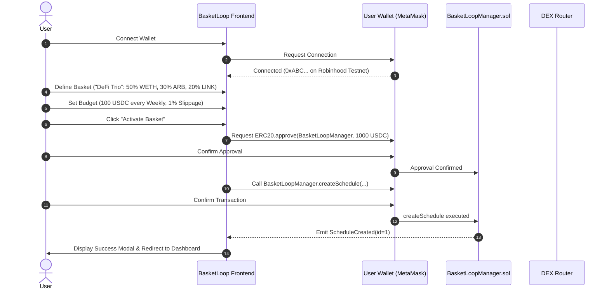
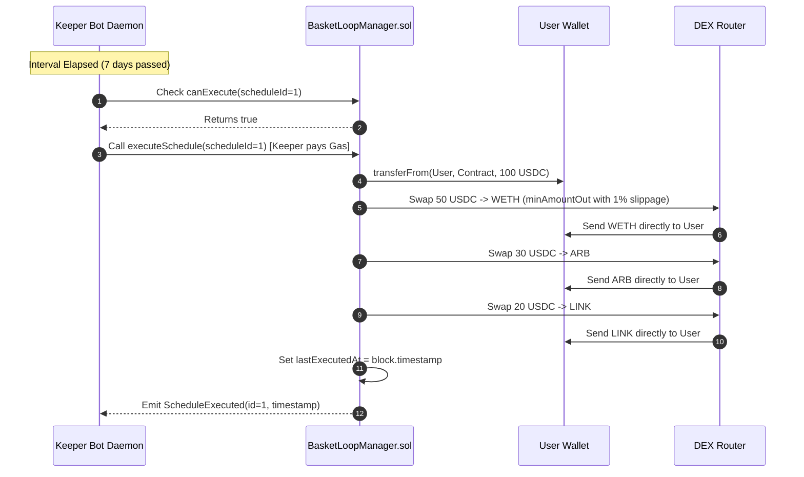
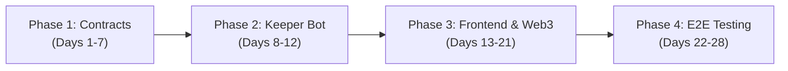

# Product Requirements Document (PRD) — BasketLoop

**Document Version:** 1.0.0
**Status:** Approved for Implementation (MVP)
**Date:** October 15, 2026
**Target Platform:** Robinhood Chain (Arbitrum Orbit L2) / Arbitrum Sepolia Testnet
**Document Author:** Web3 Product Management & Architecture

---

## 1. Document Overview and Status

This document defines the complete product and technical requirements for **BasketLoop**, a decentralized, non-custodial recurring investment application (Basket Dollar-Cost Averaging / DCA) targeting Robinhood Chain.

* **Status:** `Draft Complete — Ready for Review`
* **Target Audience:** Smart contract engineers, frontend developers, Web3 QA testers, and product stakeholders.
* **Scope:** Testnet Minimum Viable Product (MVP) covering smart-contract-enforced automated recurring execution, multi-currency funding, custom token baskets, and an in-app portfolio dashboard.

---

## 2. Executive Summary

BasketLoop is a non-custodial decentralized application (dApp) that combines **Instant Token Swaps** with **Automated Recurring Basket DCA** on Robinhood Chain.

The application serves two complementary user needs:
1. **Instant Swaps:** A clean, gas-efficient DEX swap interface allowing users to instantly trade between any supported tokens in a single transaction directly against on-chain liquidity pools.
2. **Recurring Baskets:** An automated multi-asset portfolio accumulation engine where users bundle up to 5 assets into a customized basket with percentage allocations, set a recurring budget (e.g., 100 USDC weekly), and let non-custodial smart contracts and keeper bots automate execution while funds remain 100% in self-custody.

---

## 3. Problem Statement

### 3.1 The Manual DCA Friction
Dollar-Cost Averaging (DCA) is a proven strategy for mitigating market volatility. However, executing a multi-asset DCA strategy in self-custody Web3 requires immense manual effort:
1. **Repeated Manual Actions:** An investor allocating to 4 assets every Monday must connect their wallet, calculate math manually (e.g., "$25 of Asset A, $25 of Asset B"), and sign 4 separate transactions every week.
2. **Excessive Network Fees:** Executing individual swaps multiplies gas fees and DEX protocol fees.
3. **Execution Fatigue:** Investors frequently miss scheduled purchase days due to human error, busy schedules, or volatile gas spikes.

### 3.2 The Custodial Trap
Centralized exchanges (CEXs) offer automated recurring buys, but require users to surrender asset custody, pass intrusive KYC, and risk platform insolvency ("not your keys, not your coins"). Existing decentralized alternatives are either single-token only (e.g., standard DCA contracts for ETH only) or require complex multi-sig/account abstraction setups that overwhelm casual retail users.

---

## 4. Product Vision and Goals

### 4.1 Vision
To become the premier decentralized asset management automation layer for EVM networks, making multi-asset portfolio building as effortless and automated as a traditional index fund, while preserving 100% self-custody and on-chain transparency.

### 4.2 Measurable MVP Goals
1. **Execution Success Rate:** Achieve $\ge 98\%$ successful execution rate for scheduled runs when user wallet balance and allowance are sufficient.
2. **Setup Simplicity:** Allow a user to create and activate a recurring multi-token basket in under 3 minutes (measured from wallet connection to final approval).
3. **Zero Asset Custody:** 0% of user investment capital held in intermediate protocol pools or custodial contracts.
4. **Atomic Safety:** 100% atomic execution guarantee—if any token swap fails or slips beyond tolerance, the entire transaction reverts without spending user funds.

---

## 5. Target Users and User Personas

### Persona A: "The Long-Term Accumulator" (Alex, 29)
* **Background:** Software engineer with moderate crypto experience. Holds ETH and USDC in a MetaMask wallet.
* **Goals:** Wants to steadily accumulate a portfolio of ETH, WBTC, and 2 DeFi tokens every week without checking charts daily.
* **Pain Points:** Forgets to execute on Mondays; frustrated by signing multiple swap transactions and doing allocation math in a spreadsheet.
* **Why BasketLoop:** Alex configures a 4-asset basket once, funds his wallet with USDC, and lets BasketLoop execute the swaps automatically.

### Persona B: "The Web3 Ecosystem Explorer" (Elena, 24)
* **Background:** Active DeFi participant eager to explore new Layer-2 ecosystems like Robinhood Chain.
* **Goals:** Wants to test new ecosystem tokens by DCAing small amounts across niche community tokens and RWAs.
* **Pain Points:** Manually hunting DEX liquidity pools for newly deployed tokens is cumbersome and error-prone.
* **Why BasketLoop:** Elena pastes custom contract addresses into a custom basket and sets a 10-minute demo schedule on testnet to confirm execution before committing larger capital.

---

## 6. User Problems and Current Alternatives

| Feature / Dimension | Manual DEX Swapping | Centralized Exchanges (CEX) | Single-Asset Web3 DCA | **BasketLoop (MVP)** |
| :--- | :--- | :--- | :--- | :--- |
| **Asset Custody** | Non-custodial | **Custodial** (High risk) | Non-custodial | **Non-custodial (Zero custody)** |
| **Multi-Asset Baskets** | Manual (1-by-1) | Yes (Limited pairs) | No (1 token at a time) | **Yes (Up to 5 assets per basket)** |
| **Automation** | None (Manual sign) | Automated (Off-chain) | Automated (Contract) | **Automated (Keeper + Contract)** |
| **Custom ERC-20 Support** | Yes | No (Strict listings) | Limited | **Yes (Any valid DEX pair)** |
| **KYC Required** | No | Yes | No | **No** |
| **Concurrent Schedules** | N/A | Varies | Usually 1 | **Yes (Multiple concurrent)** |

---

## 7. Value Proposition and Differentiation

1. **True Non-Custodial Automation:** Unlike vaults where users deposit funds into a smart contract pool (introducing smart contract exploit risk on idle funds), BasketLoop pulls funds only at the exact second of purchase via standard ERC-20 allowances.
2. **Arbitrary Basket Composition:** Users are not constrained to pre-packaged indexes. They can combine blue chips, ecosystem tokens, and custom token contracts in custom percentages.
3. **Atomic Revert Protection:** Eliminates "half-filled" portfolios. If token #3 fails, tokens #1 and #2 are not purchased, preventing portfolio drift.
4. **Developer-Subsidized Automation (Testnet):** Users pay zero gas fees for background recurring triggers during the MVP phase.

---

## 8. Scope and Non-Goals

### 8.1 In-Scope (MVP)
* **Instant 1:1 Token Swap & Spot Trading:** Direct, single-transaction token swaps (e.g., USDC to WETH, ETH to ARB) routed directly through the AMM router.
* **Jupiter-Style Spot Trading Interface:** Market and Limit orders with genuine Binance spot reference pricing, real-time WebSocket candlestick updates, and non-custodial limit order management.
* **Interactive Responsive Trading Chart:** Area & Candlestick chart with real-time ticks, horizontal click-and-drag panning, mouse-wheel and button zoom controls, live edge return indicator, and interactive price crosshair.
* **Network Resources & Faucets Dropdown:** Direct header access to verified testnet faucets (Robinhood Chain Testnet & Arbitrum Sepolia) and block explorers.
* **Flexible Order Expiry Options:** Preset intervals (10 minutes, 1 hour, 1 day, 1 week, Never) plus Custom local date/time selection.
* Web3 wallet connection (MetaMask, Rainbow, Coinbase Wallet via Wagmi/Viem).
* Multi-basket creation with custom names (e.g., "DeFi Heavy", "L2 Bluechips").
* Support for up to 5 assets per basket with integer percentage allocations summing to 100%.
* Curated asset list + custom ERC-20 token address input (with on-chain metadata inspection: name, symbol, decimals).
* Funding currency selection (USDC, USDT, or WETH).
* Fixed-token budget definition per cycle (e.g., 50 USDC, 0.02 WETH).
* Flexible recurring intervals: Production options (Daily, Weekly, Monthly) + Demo options (Every 10 minutes, Every 1 hour).
* User-configurable slippage tolerance (0.5%, 1.0%, 3.0%, or custom up to 5.0%).
* Smart contract recurring execution manager (`BasketLoopManager.sol`) with interval-locking and spending caps.
* Background keeper bot to monitor and trigger due schedules.
* Full schedule lifecycle management: Pause, Resume, Cancel.
* In-app dashboard displaying active schedules, countdown timers, past execution logs, and balance warnings.

### 8.2 Out-of-Scope (Non-Goals for MVP)
* ❌ Transaction-based rewards or points system (Explicitly deferred to future Mainnet evaluation; not part of Testnet MVP).
* ❌ Fiat on-ramps (credit card / bank account deposits).
* ❌ Dynamic portfolio rebalancing (selling overweight assets to buy underweight assets).
* ❌ Off-chain notifications (Email, SMS, Discord webhooks, Telegram bots).
* ❌ Automated stop-loss or take-profit triggers.
* ❌ Cross-chain basket execution (all swaps must occur on the same native chain).
* ❌ Mobile native apps (iOS/Android); MVP is responsive web only.
* ❌ Complex multi-hop DEX aggregator routing algorithms (uses standard direct/single-hop AMM router for MVP).

---

## 9. Assumptions and Unresolved Questions

### 9.1 Verified Technical Facts
* **[Verified — 2026-10-15]** Robinhood Chain is an Arbitrum Orbit Layer-2 chain settling to Ethereum, using ETH as its native gas token and providing standard EVM equivalence.
* **[Verified — 2026-10-15]** Standard ERC-20 `approve` and `transferFrom` workflows allow a smart contract to pull tokens autonomously if authorized by the user, provided the caller pays gas.
* **[Verified — 2026-10-15]** Uniswap V2/V3 style AMM routers support multi-swap atomic batching inside a single smart contract execution wrapper.

### 9.2 Assumptions Requiring Validation
* **[Assumption requiring validation]** Public RPC endpoints for Robinhood Chain Testnet have sufficient uptime and rate limits to support keeper bot polling every 30 seconds. *(Fallback: Arbitrum Sepolia Testnet will be used if Robinhood Chain public RPCs are restricted or under maintenance).*
* **[Assumption requiring validation]** Standard Uniswap V2/V3 AMM testnet forks or Camelot DEX instances exist on the target testnet with sufficient liquidity pools for test assets. *(Mitigation: The team will deploy mock ERC-20 tokens and a simple testnet mock AMM router if public DEX liquidity is insufficient).*

### 9.3 Open Questions
* **[Open Question]** Will Robinhood Chain require specific transaction metadata or permissioned sequencer whitelisting for automated keeper contracts upon mainnet release?
* **[Open Question]** What are the native bridge withdrawal delays from Robinhood Chain to Ethereum L1 for production liquidity rebalancing?

---

## 10. Functional Requirements

### FR-1: Wallet & Network Management
* **FR-1.1:** The dApp must support connection via injected EVM wallets (MetaMask, Coinbase Wallet, Brave) and WalletConnect.
* **FR-1.2:** The dApp must detect the user's active network and prompt an automatic network switch if the user is not on Robinhood Chain Testnet (or Arbitrum Sepolia).
* **FR-1.3:** The dApp must display the connected wallet address (truncated: `0x12...34ab`) and native ETH balance for gas awareness.

### FR-2: Basket Creation & Customization
* **FR-2.1:** Users must be able to specify a Basket Name (1–32 characters, alphanumeric and spaces).
* **FR-2.2:** Users must be able to add between 2 and 5 assets per basket.
* **FR-2.3:** Users must be able to select assets from a default curated list or paste a 42-character hexadecimal ERC-20 contract address.
* **FR-2.4:** When a custom address is entered, the dApp must asynchronously fetch and display the token `symbol`, `decimals`, and `name`. If the address is invalid or not an ERC-20 contract, a descriptive error must be rendered.
* **FR-2.5:** Users must assign an integer percentage to each asset. The dApp must enforce that $\sum \text{allocations} = 100\%$ with a minimum of $1\%$ per asset.

### FR-3: Funding & Budget Configuration
* **FR-3.1:** Users must select a funding token (`tokenIn`) from a supported list (e.g., USDC, USDT, WETH).
* **FR-3.2:** Users must enter a fixed recurring budget in units of the funding token (e.g., `100` USDC).
* **FR-3.3:** The dApp must validate that the budget is greater than zero and exceeds minimum dust thresholds (e.g., $\ge 1$ USDC or $\ge 0.001$ WETH).

### FR-4: Schedule & Slippage Settings
* **FR-4.1:** Users must select an execution interval:
  * Demo: `Every 10 Minutes` (600s), `Every 1 Hour` (3600s).
  * Production: `Daily` (86400s), `Weekly` (604800s), `Monthly` (2592000s).
* **FR-4.2:** Users must select or enter a slippage tolerance percentage (Options: `0.5%`, `1.0%`, `3.0%`, or custom between `0.1%` and `5.0%`).

### FR-5: On-Chain Authorization & Schedule Activation
* **FR-5.1:** Activating a schedule requires two on-chain steps:
  1. `ERC-20 Approval`: User approves `BasketLoopManager` to spend the funding token (options: Exact Cycle Amount, Infinite Allowance, or Custom Cap).
  2. `createSchedule`: User signs a transaction calling `BasketLoopManager.createSchedule(...)`.
* **FR-5.2:** The smart contract must emit a `ScheduleCreated` event containing `scheduleId`, `owner`, `tokenIn`, `tokensOut`, `allocations`, `amountInPerCycle`, `intervalSeconds`, and `slippageBps`.

### FR-6: Automated Keeper Execution
* **FR-6.1:** An off-chain keeper bot must poll the contract state or index events to identify schedules where `block.timestamp >= lastExecutedAt + intervalSeconds` and `status == Active`.
* **FR-6.2:** Before submitting an on-chain transaction, the keeper must simulate `executeSchedule(scheduleId)` to verify user balance, allowance, and DEX liquidity.
* **FR-6.3:** If simulation succeeds, the keeper submits the transaction paying testnet gas.
* **FR-6.4:** The smart contract pulls `amountInPerCycle` of `tokenIn` via `transferFrom`, computes each asset's budget, executes swaps through the AMM router with minimum output checks (`minAmountOut`), and transfers purchased tokens directly to the user's wallet.
* **FR-6.5:** The contract updates `lastExecutedAt = block.timestamp` and emits `ScheduleExecuted`.

### FR-7: Schedule Lifecycle Controls
* **FR-7.1:** The schedule owner must be able to call `pauseSchedule(scheduleId)` at any time, halting future automated executions.
* **FR-7.2:** The schedule owner must be able to call `resumeSchedule(scheduleId)` to reactivate a paused schedule.
* **FR-7.3:** The schedule owner must be able to call `cancelSchedule(scheduleId)`, permanently terminating the schedule on-chain.

### FR-8: Dashboard & Telemetry
* **FR-8.1:** The dApp dashboard must list all schedules owned by the connected wallet.
* **FR-8.2:** Each schedule card must show: Basket Name, Funding Currency, Recurring Budget, Asset breakdown tags, Status badge (`Active`, `Paused`, `Completed`, `Failed`), and a live countdown timer to the next scheduled run.
* **FR-8.3:** If the user's current funding token balance is lower than `amountInPerCycle`, an amber warning badge must appear: *"Insufficient Balance for next cycle"*.
* **FR-8.4:** The dashboard must display a transaction history table with block timestamps, execution transaction hashes linked to the block explorer, tokens acquired, and status.

### FR-9: Instant 1:1 Token Swap
* **FR-9.1:** The dApp must feature a dedicated "Swap" interface for executing direct, single-transaction 1:1 token trades.
* **FR-9.2:** Users can select any input token (`tokenIn`) and output token (`tokenOut`) from the curated list or custom token contract input.
* **FR-9.3:** The interface must query the DEX router/quoter in real time and display: expected output amount, exchange rate (e.g., `1 ETH = 3,450 USDC`), estimated gas fee, and minimum received based on user slippage.
* **FR-9.4:** Swaps execute directly against the underlying AMM router (`swapExactTokensForTokens` / `swapExactETHForTokens`) in a single user-signed transaction with zero intermediary contract fees.
* **FR-9.5:** If input token is native ETH, the swap wraps or routes via native ETH swap methods; if ERC-20, user performs standard 1-click token approval before swapping.

### FR-10: Market Orders and Limit Orders (Jupiter Spot UX)
* **FR-10.1 (Segmented Mode Selector):** The trading card must feature a prominent `[ Market | Limit ]` segmented toggle inspired by Jupiter Spot (`jup.ag/spot`).
* **FR-10.2 (Market Orders):**
  * Market orders execute immediately against the active DEX router.
  * Clearly displays input amount, simulated output, minimum received based on user slippage, and estimated network gas.
  * In Robinhood Chain Testnet, executable quotes match `MockDEXRouter.getAmountsOut` with decimal normalization and are explicitly labeled as simulated mock pricing.
* **FR-10.3 (Limit Orders — Escrow & Parameter Specification):**
  * Allows users to define a target execution price (`tokenOut` per `tokenIn`) and order expiry.
  * Features quick-adjustment chips (`Market`, `+1%`, `+5%`, `+10%`) and expiry pill selectors (`10 Mins`, `1 Hour`, `1 Day`, `1 Week`, `Never`).
  * Input tokens are escrowed inside `LimitOrderManager.sol` upon order creation (via ERC-20 `transferFrom` or `payable msg.value` for native ETH).
* **FR-10.4 (Limit Orders — Execution Safety & Invariants):**
  * Automated keepers can trigger execution via `executeOrder(orderId)` when market quotes satisfy `output >= minAmountOut`.
  * The keeper cannot invent prices or redirect funds: output tokens are delivered directly to `order.maker`.
  * Reverts atomically with `PriceConditionNotMet()` if the router output falls below the target threshold.
  * Orders cannot be filled twice (`OrderNotOpen` guard).
* **FR-10.5 (Limit Orders — Cancellation & Refund Guarantee):**
  * The order maker retains 100% authority to cancel open orders at any time via `cancelOrder(orderId)`.
  * Expired orders can be refunded by anyone via `cancelExpiredOrder(orderId)`.
  * Cancelling transfers 100% of escrowed tokens directly back to `order.maker` with zero protocol retention.
* **FR-10.6 (Order Tracking Tabs):**
  * Direct Jupiter-style below-the-card tabs: `[ Open Orders (N) | Order History ]`.
  * Displays token pair, escrowed amount, target price, minimum output, expiry countdown, and a one-click `Cancel & Refund` button.

---

## 11. User Stories and User Journeys

### User Journey 1: Creating a Weekly Basket

### User Journey 2: Automated Background Execution

---

## 12. Prioritized P0 / P1 / P2 Feature List

### P0 — Essential MVP (Required for Functional Proof of Concept)

#### P0-1: `BasketLoopManager.sol` Smart Contract
* **What it does:** Core non-custodial contract managing schedule registries, cycle intervals, spending caps, and atomic swap execution.
* **Why essential:** Enforces non-custodial invariants and guarantees no unauthorized token pulling.
* **User-Visible Outcome:** User can trust that funds are only touched according to their exact parameters.
* **Technical Dependencies:** OpenZeppelin `Ownable`, `ReentrancyGuard`, `IERC20`, `SafeERC20`, and DEX Router interface.
* **Acceptance Criteria:** Must pass all atomic revert unit tests and prevent non-owners from modifying schedules.
* **Out of Scope:** Dynamic fee splitting or rebalancing logic.

#### P0-2: Basket Builder & Allocation Validator
* **What it does:** Interactive UI to select/add up to 5 tokens, configure integer allocation sliders, and validate $\sum = 100\%$.
* **Why essential:** Eliminates configuration mistakes before submitting on-chain transactions.
* **User-Visible Outcome:** Responsive UI preventing submission unless inputs are 100% mathematically valid.
* **Technical Dependencies:** React Hook Form / Zod, Viem for ERC-20 contract calls.
* **Acceptance Criteria:** Submit button is disabled if total $\ne 100\%$ or if any token allocation is $< 1\%$.
* **Out of Scope:** Portfolio backtesting charts or historical performance projections.

#### P0-3: Multi-Currency Funding Selector
* **What it does:** Allows users to choose whether to fund the basket in USDC, USDT, or WETH with fixed-token budget amounts.
* **Why essential:** Accommodates diverse wallet holdings without forcing manual pre-swaps.
* **User-Visible Outcome:** Dropdown selector showing user's live balance for each funding currency.
* **Technical Dependencies:** ERC-20 `balanceOf` hooks.
* **Acceptance Criteria:** Disallows selecting a funding token if user wallet balance is 0.
* **Out of Scope:** Multi-token split funding (funding 50% in USDC and 50% in ETH for the same basket).

#### P0-4: Dual Interval System (Production + Demo Timers)
* **What it does:** Enables testing cycles (10 min, 1 hour) alongside standard cycles (Daily, Weekly, Monthly).
* **Why essential:** Critical for testing and live demonstration without waiting 7 days for a recurring run.
* **User-Visible Outcome:** Simple radio/dropdown buttons in schedule configuration.
* **Technical Dependencies:** Unix timestamp arithmetic in Solidity.
* **Acceptance Criteria:** Contract strictly rejects execution if `block.timestamp < lastExecutedAt + intervalSeconds`.
* **Out of Scope:** Cron-syntax custom scheduling (e.g., "Every 2nd Tuesday at 3 PM").

#### P0-5: Atomic Batch Swap Engine
* **What it does:** Swaps `tokenIn` into all target basket assets within a single transaction using the DEX router.
* **Why essential:** Protects user from partial execution, portfolio skew, and stranded dust.
* **User-Visible Outcome:** All tokens arrive in user wallet simultaneously, or zero tokens are swapped.
* **Technical Dependencies:** AMM Router (Uniswap V2/V3 compatible).
* **Acceptance Criteria:** If any single token swap fails (e.g., liquidity dried up), the entire transaction reverts.
* **Out of Scope:** Splitting swaps across multiple different DEXs in the same batch.

#### P0-6: Subsidized Keeper Daemon
* **What it does:** Node.js/TypeScript background runner that periodically queries active schedules and submits execution calls.
* **Why essential:** Powers the "set-it-and-forget-it" hands-off user experience.
* **User-Visible Outcome:** Purchases happen on schedule without user opening the app.
* **Technical Dependencies:** Viem/Ethers.js, cron runner, developer relayer private key with testnet ETH.
* **Acceptance Criteria:** Keeper detects and executes due schedules within 60 seconds of schedule maturity.
* **Out of Scope:** Decentralized keeper networks (Chainlink Automation / Gelato integration).

#### P0-7: Portfolio & Schedule Dashboard
* **What it does:** Displays active/paused schedules, countdown clocks, balance warnings, and action buttons (Pause, Resume, Cancel).
* **Why essential:** Complete transparency and management control over active automations.
* **User-Visible Outcome:** Clean dashboard cards with real-time status.
* **Technical Dependencies:** React, Tailwind CSS, Wagmi hooks.
* **Acceptance Criteria:** Status changes reflect immediately upon transaction confirmation.
* **Out of Scope:** Tax reporting exports or PnL dollar performance graphs.

#### P0-8: Instant 1:1 Token Swap Engine
* **What it does:** Allows users to perform immediate 1:1 token swaps directly against the DEX router without creating a basket or recurring schedule.
* **Why essential:** Provides a complete DEX trading experience, allowing users to acquire funding assets or rebalance on demand.
* **User-Visible Outcome:** Intuitive swap card with input/output token selectors, live quote calculation, slippage settings, and a 1-click swap confirmation.
* **Technical Dependencies:** Direct integration with DEX router (`swapExactTokensForTokens` / `swapExactETHForTokens`) via Wagmi/Viem.
* **Acceptance Criteria:** Swaps execute immediately in 1 transaction; output tokens arrive in user wallet; UI refreshes balances instantly.
* **Out of Scope:** Limit orders, DCA-in-swap hybrids.

---

### P1 — Important Next Iteration (Post-MVP)
* **P1-1: Pre-set Curated Templates:** "Top 3 DeFi", "Ethereum L2 Index", "RWA Basket".
* **P1-2: Dollar-Value Oracles:** Chainlink/Pyth oracle integration allowing budgets defined in USD (e.g., "$100 of ETH").
* **P1-3: Off-Chain Notifications:** Email or Telegram bot alerts 24 hours before execution and after execution.
* **P1-4: Gelato / Chainlink Automation Keeper:** Replacing the developer-run keeper bot with a decentralized automation network.

### P2 — Optional / Future Scope
* **P2-1: Automatic Portfolio Rebalancing:** Periodic selling and buying to restore target percentage weights.
* **P2-2: Social Basket Sharing:** Public URLs allowing users to share basket compositions with one-click cloning.
* **P2-3: Cross-Chain Swaps:** Funding a basket on Arbitrum to purchase assets on Optimism or Base via Chainlink CCIP.
* **P2-4: Transaction-Based Rewards / Points System (Deferred to Future Mainnet Consideration):**
  * *Status:* Strictly deferred to future Mainnet evaluation; omitted from the current Testnet MVP.
  * *Preliminary Concept (Non-Binding Idea):* Potential internal reward metric (e.g., 1 point per $100 of eligible, successfully completed transaction volume).
  * *Open Decisions to Resolve Prior to Mainnet:* Decide whether transaction value accumulates cumulatively across micro-transactions; establish verified token eligibility rules to prevent wash trading; define trusted USD valuation sources; specify ledger architecture (off-chain indexer vs. database).
  * *Non-Monetary Disclaimer:* Points are strictly preliminary, non-transferable internal accounting metrics with zero promised or guaranteed monetary value, no token redemption, and no cryptocurrency conversion.

---

## 13. Acceptance Criteria

### AC-1: Basket Configuration & Allocation Validation
* **AC-1.1 (Positive):** Given 3 selected tokens with allocations 50%, 30%, and 20%, when the user clicks "Continue", the wizard advances to Budget settings.
* **AC-1.2 (Negative - Under 100%):** Given allocations summing to 95%, the system displays *"Total allocation must equal 100% (currently 95%)"* and disables submission.
* **AC-1.3 (Negative - Over 100%):** Given allocations summing to 105%, the system displays *"Total allocation must equal 100% (currently 105%)"* and disables submission.
* **AC-1.4 (Edge - Asset Limits):** The UI prevents adding a 6th asset (Add Asset button disabled at 5 assets) and prevents deleting below 2 assets.
* **AC-1.5 (Edge - Duplicate Assets):** If a user selects a token already present in the basket, the system displays *"Asset already added"* and prevents duplicate entry.

### AC-2: Custom Token Validation
* **AC-2.1 (Positive):** Given a valid ERC-20 contract address on the target network, when pasted, the UI fetches and renders the token symbol (e.g., `TEST`), name, and decimals within 2 seconds.
* **AC-2.2 (Negative - Non-Contract):** When a user pastes a regular EOA wallet address or invalid hash, the UI displays *"Address is not a valid ERC-20 token contract"*.
* **AC-2.3 (Negative - Self-Reference):** When a user enters the funding token address as a basket output token, the UI displays *"Output asset cannot be the same as the funding asset"*.

### AC-3: Smart Contract Execution & Non-Custodial Invariants
* **AC-3.1 (Timing Guard):** If `executeSchedule(id)` is called when `block.timestamp < lastExecutedAt + interval`, the transaction must revert with `ScheduleNotDue()`.
* **AC-3.2 (Authorization Guard):** If a user attempts to pause or cancel a schedule they do not own, the call must revert with `NotScheduleOwner()`.
* **AC-3.3 (Spending Invariant):** The smart contract must never pull more than `amountInPerCycle` per execution call.
* **AC-3.4 (Custody Invariant):** At the end of `executeSchedule`, `tokenIn.balanceOf(address(contract))` and `tokensOut[i].balanceOf(address(contract))` must remain `0`. No funds may remain stranded in the contract.

### AC-4: Atomic Revert on Failure
* **AC-4.1 (Insufficient Balance):** If the user's wallet contains 40 USDC when the schedule requires 100 USDC, the execution simulation fails, the keeper skips submission, and the dashboard marks the schedule with an amber alert *"Insufficient Balance"*.
* **AC-4.2 (Slippage Revert):** If price moves sharply and the DEX cannot satisfy `minAmountOut` for token #2, the swap reverts. The entire transaction reverts atomically; 0 USDC is pulled from the user wallet.

### AC-5: Instant Swap Acceptance Criteria
* **AC-5.1 (Instant Trade Execution):** Given a connected wallet with sufficient balance and approval, when the user clicks "Swap", the transaction executes against the DEX router and newly acquired tokens appear in the wallet upon block confirmation.
* **AC-5.2 (Quote Reactivity):** When the user modifies the input amount or switches tokens, the estimated output and exchange rate update within 500ms via live RPC quoter calls.
* **AC-5.3 (Slippage Enforcement):** If market price moves beyond the user's slippage tolerance between submission and block inclusion, the swap reverts, gas is spent, and user input tokens remain in the wallet.
* **AC-5.4 (Native ETH Wrap/Unwrap):** If swapping between native ETH and WETH or another ERC-20, the UI automatically triggers the correct router method without requiring manual wrapping.

---

## 14. Business Rules and Validation Rules

1. **Allocation Sum Rule:** $\sum_{i=1}^{N} \text{allocation}_i = 10000 \text{ basis points } (100.00\%)$.
2. **Asset Count Rule:** $2 \le N \le 5$ assets per basket.
3. **Minimum Asset Allocation Rule:** Each asset must have an allocation $\ge 100 \text{ bps } (1.00\%)$.
4. **Interval Enforcement Rule:** Execution timestamp must satisfy:
   $$\text{block.timestamp} \ge \text{lastExecutedAt} + \text{intervalSeconds}$$
5. **Direct Custody Rule:** The contract must forward all acquired swap tokens immediately to the schedule owner address within the execution transaction.
6. **Concurrent Schedule Rule:** A single wallet address may create and maintain up to 10 active concurrent schedules.
7. **Slippage Clamp Rule:** Slippage tolerance must be clamped between $10 \text{ bps } (0.1\%)$ and $500 \text{ bps } (5.0\%)$. Default is $100 \text{ bps } (1.0\%)$.

---

## 15. Failure Scenarios and Recovery Behavior

| Failure Scenario | Root Cause | System Response | User Recovery Action |
| :--- | :--- | :--- | :--- |
| **Insufficient Funding Balance** | User spent or moved funding tokens before scheduled day. | Keeper simulation fails; transaction is not broadcast. Dashboard displays warning alert. | User deposits funding tokens into wallet. Keeper automatically executes on next polling pass. |
| **Revoked / Insufficient Allowance** | User reduced ERC-20 spending cap in wallet. | Transaction reverts with `ERC20InsufficientAllowance`. Schedule marked `Needs Approval`. | User clicks "Re-approve Allowance" button on the dashboard card. |
| **DEX Route / Liquidity Failure** | Custom token has zero liquidity pool against funding token. | Keeper simulation reverts with `NoRouteFound` or `InsufficientLiquidity`. | User cancels schedule or replaces custom token with a liquid asset. |
| **Slippage Exceeded** | Market volatility caused swap output to fall below `minAmountOut`. | Atomic revert inside smart contract. Zero funds spent; keeper retries after 10 minutes. | User increases slippage tolerance in schedule settings or waits for market to stabilize. |
| **RPC Endpoint Outage** | Public testnet RPC goes offline or rate-limits requests. | Keeper bot fails over to secondary RPC endpoint (e.g., Alchemy / Infura fallback). | Transparent to user; execution resumes once RPC is reachable. |

---

## 16. Security, Privacy, and Trust Requirements

### 16.1 Threat Model and Security Invariants
* **Invariant 1 (Pull Limit):** The contract can never pull more than `amountInPerCycle` per cycle, preventing draining even if an infinite allowance was granted.
* **Invariant 2 (Interval Lock):** An execution cannot be called multiple times in rapid succession (replay / sandwich attack protection).
* **Invariant 3 (Reentrancy Protection):** All state-changing methods must implement OpenZeppelin's `ReentrancyGuard` to prevent reentrancy during external token transfers and DEX interactions.
* **Invariant 4 (Zero Idle Custody):** The contract must hold zero user balances between executions.

### 16.2 Token Approval Safety
* The dApp must offer the user two distinct approval choices:
  1. **Exact Cycle Approval:** Approve only enough for the upcoming cycle (requires manual re-approval each time, or approval of $N$ cycles).
  2. **Continuous Automation Approval:** Approve a user-specified spending cap (e.g., 500 USDC for 5 cycles) or standard max approval, with clear explanation that the smart contract's internal code strictly caps each individual pull to `amountInPerCycle`.

### 16.3 Data Privacy
* BasketLoop is a fully client-side dApp.
* No user IP addresses, email addresses, or physical identities are collected, logged, or transmitted to any centralized database.
* Schedule state is read entirely from public on-chain events and smart contract view functions.

---

## 17. External Integrations and Technical Dependencies

### 17.1 Blockchain Layer
* **Primary Target:** Robinhood Chain Testnet (Arbitrum Orbit Layer-2).
* **RPC Endpoint:** Official Robinhood Chain Testnet RPC / WebSocket.
* **Development Fallback:** Arbitrum Sepolia Testnet (Chain ID: `421614`).
* **Gas Token:** Testnet ETH.

### 17.2 Decentralized Exchange (DEX) Integration
* **Protocol:** Uniswap V2 / V3 compatible router deployed on the target testnet.
* **Router Interface:** `ISwapRouter` / `IUniswapV2Router02`.
* **Execution Path:** Direct swap `tokenIn -> tokenOut[i]` using default intermediate routing (e.g., WETH base pair).

### 17.3 Web3 Frontend Stack
* **Framework:** Next.js 14+ (App Router), TypeScript, Tailwind CSS.
* **Web3 Library:** Wagmi v2, Viem, RainbowKit.
* **State Management:** TanStack Query (React Query).

### 17.4 Background Keeper Service
* **Runtime:** Node.js (TypeScript) running as a persistent daemon (PM2 or Docker container).
* **Signer:** Developer-controlled relayer wallet with funded testnet ETH.
* **Libraries:** Viem for contract event polling and gas-optimized transaction dispatching.

---

## 18. High-Level Product Constraints

1. **Single Developer Feasibility:** Architecture must be simple enough for a single developer with beginner-to-intermediate Web3 experience to implement within 3–4 weeks.
2. **Zero Protocol Fees in MVP:** No protocol fee deduction on swaps to eliminate tax/fee edge cases.
3. **No External Price Oracle Dependency:** Budgets are denominated directly in the funding token (e.g., 100 USDC), avoiding reliance on volatile testnet oracle price feeds.
4. **EVM Equivalence:** All smart contracts must use standard Solidity (`^0.8.20`) with no non-standard opcode modifications.

---

## 19. UX Requirements and Important Screens

### Screen 0: Instant Swap Interface (Default Tab or "/swap")
* Main navigation tabs: `[ Swap ]` | `[ Baskets ]`.
* Standard DeFi swap card layout:
  * "You Pay": Amount input field, Token selector dropdown with icon/symbol, Live user balance display with "Max" button.
  * Invert button (↕) to quickly flip `tokenIn` and `tokenOut`.
  * "You Receive": Read-only estimated output field with real-time quote updates.
  * Details accordion: Exchange rate, Minimum received (after slippage), Slippage setting gear icon (`0.5%`, `1.0%`, `3.0%`, `Custom`), Price impact estimate, Network gas fee.
  * Action Button: Context-aware CTA button:
    * "Connect Wallet" (if disconnected).
    * "Insufficient [Token] Balance" (if input > balance).
    * "Approve [Token]" (if ERC-20 spending allowance is insufficient).
    * "Swap" (triggers instant DEX swap transaction).

### Screen 1: Wallet Connection & Empty State (Baskets Tab)
* Top navigation bar with Logo, Navigation Tabs (`Swap`, `Baskets`), Network Indicator, and "Connect Wallet" button.
* Empty state hero card: *"Automate your crypto portfolio. Build a basket, set your schedule, and let Web3 work for you."* with a primary CTA button: **"Create Your First Basket"**.

### Screen 2: Basket Builder (Step 1 of 2)
* Basket Name text input.
* Asset selection grid with search filter.
* Asset list showing token icon, symbol, and percentage slider (1% to 100%).
* Custom Token Input: Input field to paste 42-character contract address with instant validation and a "+ Add Custom Token" button.
* Allocation Progress Bar: Visual bar showing total percentage. Colors: Blue (under 100%), Green (exactly 100%), Red (over 100%).
* "Next: Set Schedule" button (enabled only when total = 100%).

### Screen 3: Schedule & Budget Configuration (Step 2 of 2)
* Funding Token selector (USDC, USDT, WETH).
* Recurring Budget input field with user balance display and "Max" helper.
* Interval Selector:
  * Segmented control: `Demo Mode` | `Standard Mode`.
  * Demo: [ Every 10 Minutes ] [ Every 1 Hour ].
  * Standard: [ Daily ] [ Weekly ] [ Monthly ].
* Advanced Settings toggle: Slippage tolerance picker (`0.5%`, `1.0%`, `3.0%`, `Custom`).
* Summary Box: Clear breakdown: *"You will invest 100 USDC every Weekly (~50 USDC into WETH, ~30 USDC into ARB, ~20 USDC into LINK)"*.
* CTA Button: **"Review & Activate"**.

### Screen 4: Activation Modal
* Step 1: "Approve USDC Spending" (Triggers wallet ERC-20 approval).
* Step 2: "Confirm Schedule Creation" (Triggers `createSchedule` transaction).
* Progress spinners and block explorer links for each step.

### Screen 5: Active Schedules Dashboard
* Summary Header: Total Active Baskets, Next Execution Countdown.
* Schedule Cards:
  * Title, Status badge (`Active` in green, `Paused` in yellow, `Alert` in red).
  * Allocation mini-tags (e.g., `50% WETH`, `30% ARB`, `20% LINK`).
  * Recurring Budget & Interval tag (e.g., `100 USDC / Weekly`).
  * Action Menu: `Pause`, `Resume`, `Cancel Schedule`.
* Transaction History Table:
  * Columns: Date/Time, Basket Name, Amount In, Assets Received, Explorer Tx Link, Status.

---

## 20. Analytics and Success Metrics

Even in a privacy-preserving non-custodial dApp, key on-chain metrics must be tracked:

1. **Total Baskets Created:** Total count of `ScheduleCreated` events emitted.
2. **Total Execution Volume:** Cumulative amount of `tokenIn` processed across all `ScheduleExecuted` events.
3. **Execution Reliability Rate:**
   $$\text{Reliability} = \frac{\text{Successful Executions}}{\text{Total Trigger Attempts}} \times 100\% \quad (\text{Target: } \ge 98\%)$$
4. **Active vs. Churned Schedules:** Ratio of currently `Active` schedules versus `Cancelled` schedules.
5. **Most Popular Assets:** Top 10 tokens by basket allocation frequency.

---

## 21. Testing and Validation Strategy

### 21.1 Smart Contract Automated Tests (Foundry / Hardhat)
* **Unit Tests:**
  * Allocation sum validation ($\ne 100\%$ reverts).
  * Schedule timing validation (early calls revert with `ScheduleNotDue`).
  * Access control checks (non-owner pause/cancel reverts).
* **Integration Tests (Forked Testnet):**
  * Successful execution pulling USDC and delivering multiple tokens.
  * Revert on zero liquidity or excessive slippage.
  * Revert on insufficient user balance without modifying state.
* **Invariant Tests:**
  * Contract token balances always return to zero at end of transaction.
  * User balance never decreases by more than `amountInPerCycle`.

### 21.2 Keeper Daemon Testing
* Simulate network disconnects and verify keeper retries without duplicate executions.
* Verify gas price spikes do not crash the keeper process.

### 21.3 End-to-End (E2E) Frontend Testing
* Cypress / Playwright test flows with synthetic MetaMask provider:
  1. Connect wallet -> Build 3-asset basket -> Approve -> Create schedule.
  2. Verify dashboard renders schedule card with correct countdown.
  3. Pause schedule -> Verify badge updates to `Paused`.
  4. Resume schedule -> Verify badge updates to `Active`.
  5. Cancel schedule -> Verify card is removed or marked `Cancelled`.

---

## 22. Risks and Mitigations

| Risk | Impact | Likelihood | Mitigation Strategy |
| :--- | :--- | :--- | :--- |
| **DEX Liquidity Thin on Testnet** | High | High | Deploy dedicated Mock ERC-20 tokens and seed a local Testnet Uniswap V2 pair with ample mock liquidity. |
| **Keeper Wallet Runs Out of Gas** | Medium | Medium | Implement an automated Telegram/email alert when the keeper relayer wallet balance falls below 0.05 testnet ETH. |
| **Custom Token Honeypot / Transfer Fee** | High | Low | Implement static simulation (`eth_call`) before executing swaps; reject tokens that deduct a transfer fee on transfer. |
| **User Revokes Approval Unexpectedly** | Low | Medium | Contract gracefully fails; dashboard flags schedule with clear UI alert prompting re-approval. |
| **RPC Rate Limiting** | Medium | Low | Use exponential backoff in keeper polling loop and configure fallback RPC providers. |

---

## 23. MVP Milestones and Implementation Phases

* **Phase 1: Smart Contracts (Days 1–7):**
  * Develop `BasketLoopManager.sol` and mock tokens.
  * Write 100% test coverage suite for schedule creation, pause, cancel, and swap execution.
  * Deploy to Robinhood Chain Testnet / Arbitrum Sepolia.
* **Phase 2: Keeper Service (Days 8–12):**
  * Build TypeScript keeper daemon with Viem.
  * Implement interval polling, pre-flight simulation, and error logging.
* **Phase 3: Frontend dApp (Days 13–21):**
  * Scaffold Next.js application with Tailwind CSS and RainbowKit.
  * Build Basket Builder, Schedule Configurator, and Dashboard.
  * Integrate contract read/write hooks.
* **Phase 4: Integration, Testing & Polish (Days 22–28):**
  * Perform complete multi-cycle runs on testnet with 10-minute demo intervals.
  * Conduct UI edge-case polish and error-handling audit.
  * Finalize user documentation and demo video.

---

## 24. Definition of Done (DoD)

The BasketLoop MVP is considered complete and ready for release when:
1. All P0 features are implemented, deployed to testnet, and functional.
2. Smart contract test suite achieves $\ge 95\%$ line and branch test coverage.
3. A user can complete the full lifecycle: Create basket -> Background execution succeeds on 10-minute interval -> Tokens arrive in wallet -> User pauses/cancels schedule.
4. Dashboard accurately reflects real-time on-chain state without requiring manual page refreshes.
5. Zero critical or high-severity vulnerabilities identified in the internal security checklist.

---

## 25. Glossary

* **DCA (Dollar-Cost Averaging):** An investment strategy of buying a fixed dollar or token amount of assets at regular intervals regardless of price.
* **Non-Custodial:** A system architecture where users maintain exclusive ownership of their private keys and assets at all times.
* **Keeper Bot:** An off-chain script or program that monitors on-chain conditions and submits transactions to trigger smart contract executions.
* **Atomic Transaction:** An all-or-nothing smart contract execution; if any internal step fails, the entire transaction reverts and all state changes are undone.
* **Slippage:** The difference between the expected price of a trade and the actual executed price on an AMM.
* **Bps (Basis Points):** A unit of measure where $1 \text{ bps} = 0.01\%$, and $10,000 \text{ bps} = 100.00\%$.
* **EOA (Externally Owned Account):** A standard crypto wallet address controlled by a private key (e.g., MetaMask).

---

## 26. References and Verified Technical Facts

1. **Arbitrum Orbit Architecture:**
   *Arbitrum Documentation* — Explains Layer-2 rollup mechanisms, EVM execution, and gas models.
   Link: [https://docs.arbitrum.io/launch-orbit-chain/orbit-gentle-introduction](https://docs.arbitrum.io/launch-orbit-chain/orbit-gentle-introduction) (Verified: October 2026).
2. **Uniswap V2 / V3 Router Specifications:**
   *Uniswap Developer Portal* — Technical documentation on `swapExactTokensForTokens` and minimum output slippage protection.
   Link: [https://docs.uniswap.org/contracts/v2/reference/smart-contracts/router-02](https://docs.uniswap.org/contracts/v2/reference/smart-contracts/router-02) (Verified: October 2026).
3. **OpenZeppelin Security Standards:**
   *OpenZeppelin Contracts v5.0* — Reference implementations for `SafeERC20`, `ReentrancyGuard`, and `Ownable`.
   Link: [https://docs.openzeppelin.com/contracts/5.x/](https://docs.openzeppelin.com/contracts/5.x/) (Verified: October 2026).
